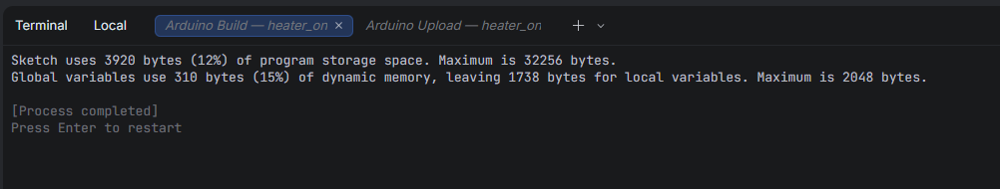
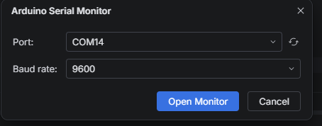
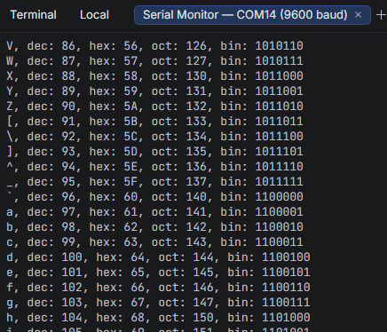

# OpenIDEA Arduino Plugin

Arduino integration for [OpenIDEA](https://github.com/l0ng-ai/openidea):
- **Build Sketch**: Compiles the active `.ino` sketch with the configured board via `arduino-cli`.
- **Upload Sketch**: Compiles and uploads sketch to connected microcontroller board.
- **Serial Monitor**: Opens interactive serial monitor tab with selectable baud rate (`9600`, `115200`, etc.).
- **Board & Port Pickers**: Interactive pickers with automatic board listall and connected serial port discovery.

## Requirements

- [OpenIDEA](https://github.com/l0ng-ai/openidea)
- [Arduino CLI](https://arduino.github.io/arduino-cli/) or [Arduino IDE 2](https://www.arduino.cc/en/software)

## Commands

- `Arduino: Select Board` (`mushketer888.arduino.select-board`)
- `Arduino: Select Port` (`mushketer888.arduino.select-port`)
- `Arduino: Build Sketch` (`mushketer888.arduino.build`)
- `Arduino: Upload Sketch...` (`mushketer888.arduino.upload`)
- `Arduino: Serial Monitor...` (`mushketer888.arduino.serial-monitor`)

## Permissions & Capabilities

This plugin declares the minimum capabilities required to drive `arduino-cli` from OpenIDEA:

- **`process:arduino-cli`** (required, High risk): Invokes the locally installed `arduino-cli` executable to list boards/ports, compile sketches, upload firmware, and run the interactive serial monitor. Exact commands executed:
  - `arduino-cli board listall --format json` — lists installed boards in **Arduino: Select Board**.
  - `arduino-cli board list --format json` — detects connected serial ports and attached boards in **Arduino: Select Port**.
  - `arduino-cli compile --fqbn <board> <sketch>` — compiles the active `.ino` sketch (or project root) in an integrated terminal tab (**Arduino: Build Sketch**).
  - `arduino-cli upload -p <port> --fqbn <board> <sketch>` — uploads the compiled sketch to the selected board and port (**Arduino: Upload Sketch...**).
  - `arduino-cli monitor -p <port> [-b <board>] -c baudrate=<baud>` — opens an interactive serial monitor terminal session (**Arduino: Serial Monitor...**).
- **`project.read`** (required): Reads the active project root path as a fallback sketch directory when no `.ino` editor is focused.
- **`storage`** (required): Persists the selected board FQBN (`board`) and serial port (`port`) in plugin storage.

## Building from Source

```sh
rustup target add wasm32-wasip2
cargo test
openidea-plugin build
```

## Screenshots

### Build Sketch


### Serial Monitor Config


### Serial Monitor Live Data


## License

[Apache 2.0](LICENSE)
